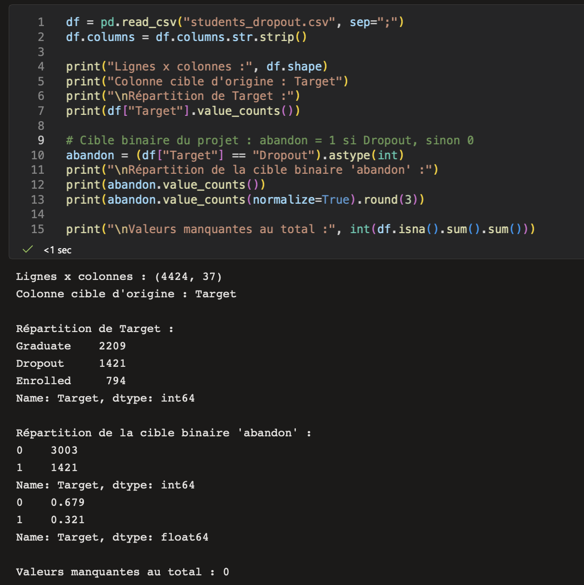
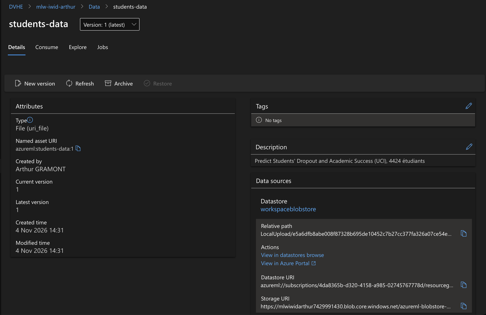
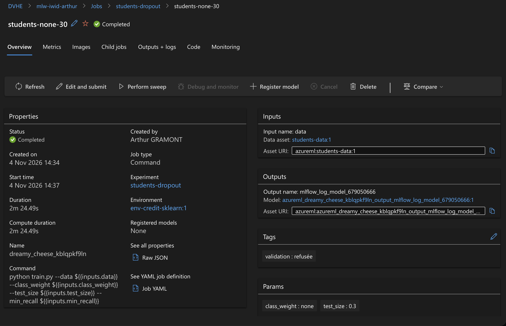
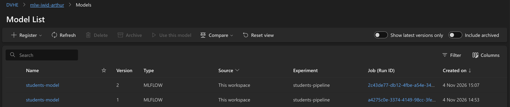
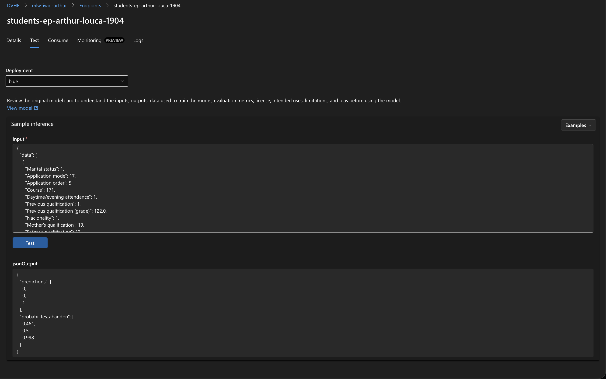
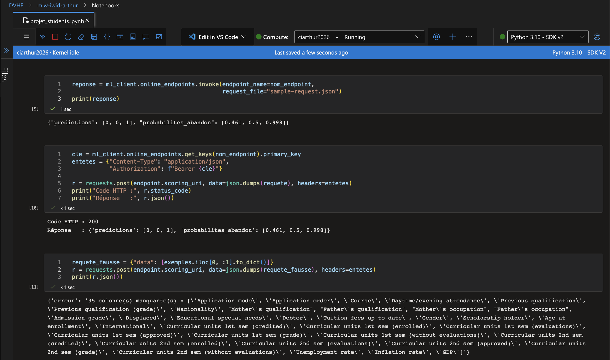

# Groupe 5 (Sujet F) – Predict Students' Dropout and Academic Success

### Membres : Louca Baignères & Arthur Gramont

Projet MLOps sur Azure Machine Learning.

## Données
- Source : UCI, Predict Students' Dropout and Academic Success (4 424 étudiants d'une
  université portugaise, 36 variables numériques, aucune valeur manquante).
- Cible d'origine : `Target` (Dropout / Enrolled / Graduate : 1 421 / 794 / 2 209). Cible binaire créée :
  `abandon` (1 = Dropout, 0 = sinon).
- Répartition de la cible binaire : 32,1 % d'abandon (1 421 étudiants), 67,9 % sans abandon
  (3 003 étudiants).
- Préparation : séparateur point-virgule, nettoyage des noms de colonnes (tabulation
  parasite), création de la cible dans train.py. Data asset : `students-data` (v1).

## Métrique choisie et seuil
- Métrique : recall sur la classe « abandon ».
- Pourquoi : rater un étudiant qui va abandonner (faux négatif) coûte plus cher qu'une
  alerte inutile (faux positif : un simple entretien de suivi). L'accuracy est moins
  pertinente car la classe abandon est minoritaire.
- Seuil : recall >= 0.7. Justification : le seuil est volontairement exigeant par rapport au défaut du script (0.5) mais
  reste sous le meilleur recall obtenu avec `class_weight=balanced` (0.84).
- Modèle enregistré : `students-model`, uniquement si le seuil est atteint (tag
  `validation` = acceptée ou refusée).

## Résultats
Entraînement : régression logistique + `StandardScaler`, découpage stratifié, `random_state=42`.

| Run | class_weight | test_size | accuracy | precision | recall | f1 |
|---|---|---|---|---|---|---|
| students-none-30 | none | 0.3 | 0.889 | 0.882 | 0.754 | 0.813 |
| students-balanced-30 | balanced | 0.3 | 0.874 | 0.783 | 0.843 | 0.812 |
| students-balanced-20 | balanced | 0.2 | 0.873 | 0.787 | 0.831 | 0.808 |

L'AUC est quasi identique pour les trois runs (0.927 à 0.931) : la pondération déplace le compromis precision / recall, pas la capacité de séparation du modèle.

Meilleur recall : students-balanced-30, 0.843. Pipeline : `pipeline-balanced` (prep -> train) a enregistré la
version 1 de `students-model` (validation = acceptée). Endpoint testé en studio, avec
le SDK et avec requests ; la requête incorrecte (une seule colonne envoyée) renvoie :
`{'erreur': "35 colonne(s) manquante(s) : ['Application mode', 'Application order', 'Course', ...]"}`.

> Attention : un second pipeline (`pipeline-none`, `class_weight=none`) a été lancé avec le même seuil de 0.7. Son recall (0.754) dépasse aussi le seuil : il a donc créé la version 2 de `students-model`, et c'est cette version (`label="latest"`) qui a été déployée. Pour déployer le modèle `balanced`, il faut cibler la version 1, ou monter le seuil au-dessus de 0.754 (par exemple 0.8) pour que `none` soit refusé.

## Déploiement
- Endpoint managé `students-ep-arthur-louca-1904` (auth par clé, région germanywestcentral), déploiement `blue` sur `Standard_F2s_v2`, 100 % du trafic.
- Script de scoring [deploy/score.py](deploy/score.py) : charge le modèle MLflow, vérifie les colonnes reçues et renvoie `predictions` et `probabilites_abandon`, ou un message d'erreur explicite.
- Environnement [deploy/conda-deploy.yml](deploy/conda-deploy.yml) : Python 3.10, scikit-learn 1.5.2, mlflow 2.22.0.
- Exemple de réponse sur [sample-request.json](sample-request.json) (3 étudiants, abandon réel `[1, 0, 1]`) : `{"predictions": [0, 0, 1], "probabilites_abandon": [0.461, 0.5, 0.998]}`.

## Structure du dépôt
| Fichier | Rôle |
|---|---|
| [projet_students.ipynb](projet_students.ipynb) | Notebook orchestrant tout le projet (SDK Azure ML v2) |
| [students_dropout.csv](students_dropout.csv) | Jeu de données (séparateur `;`) |
| [src/train.py](src/train.py) | Entraînement, métriques MLflow, enregistrement conditionnel au recall |
| [pipeline/prep.py](pipeline/prep.py) | Étape 1 du pipeline : nettoyage (NA, doublons) |
| [deploy/](deploy/) | Script de scoring et environnement conda de l'endpoint |
| [captures/](captures/) | Captures d'écran des étapes du projet |
| [.github/workflows/test-azure.yml](.github/workflows/test-azure.yml) | GitHub Actions : connexion à Azure sans mot de passe (OIDC) et liste des workspaces |

## Étapes du projet
1. Exploration des données.
2. Création du data asset `students-data`.
3. Entraînement d'un premier job (`students-none-30`) sur le cluster `ccarthur`, avec `min_recall=1.1` (jamais atteint) pour ne rien enregistrer.
4. Comparaison de trois runs via MLflow (experiment `students-dropout`).
5. Pipeline prep -> train avec validation du seuil (experiment `students-pipeline`).
6. Déploiement sur un endpoint en ligne et tests (studio, SDK, requests).

## Utilisation
Prérequis : un workspace Azure ML (`config.json`), un cluster de calcul et l'environnement `env-credit-sklearn:1`.

```bash
# entraînement local, par exemple
python src/train.py --data students_dropout.csv --class_weight balanced --test_size 0.3 --min_recall 0.7
```

Le reste s'exécute cellule par cellule dans le notebook. Le workflow GitHub Actions nécessite les secrets `AZURE_CLIENT_ID`, `AZURE_TENANT_ID` et `AZURE_SUBSCRIPTION_ID`, et se lance manuellement (`workflow_dispatch`).

## Preuves (captures d'écran)
Les captures sont dans [captures/](captures/).

### Étape 1 – Exploration des données


### Étape 2 – Data asset `students-data`


### Étape 3 – Premier job terminé


### Étape 4 – Comparaison des runs


### Étape 5 – Pipeline et registre des modèles


Versions de `students-model` créées par les deux pipelines (v1 à 14:53, v2 à 15:07) :



### Étape 6 – Test de l'endpoint
Test dans le studio (onglet Test) :



Test avec Python (SDK et requests) :



## Difficultés rencontrées et solutions
- Noms de colonnes avec une tabulation parasite -> `df.columns.str.strip()` dans `train.py` et `prep.py`.
- Les jobs d'exploration ne devaient rien enregistrer dans le registre -> seuil impossible (`min_recall=1.1`), l'enregistrement est réservé au pipeline.
- Le déploiement managé prend environ 10 minutes et n'est pas visible tout de suite -> fonction `attendre_deploiement` qui interroge l'état toutes les 30 s et gère `ResourceNotFoundError`.
- Chemin du modèle MLflow inconnu dans le conteneur -> `init()` parcourt `AZUREML_MODEL_DIR` pour trouver le dossier contenant `MLmodel`.
- Requêtes incomplètes ou colonnes dans le désordre -> `run()` vérifie les colonnes, les réordonne selon `feature_names_in_` et renvoie une erreur lisible plutôt qu'un crash.
